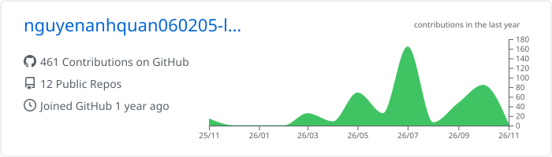
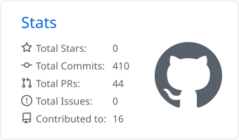
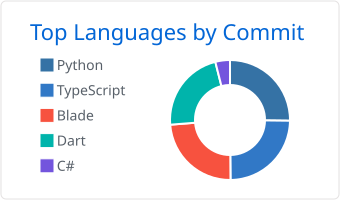

<div align="center">


<a href="https://git.io/typing-svg"></a>

<p>
<a href="mailto:nguyenanhquan060205@gmail.com"></a>
<a href="https://thesis-edu-talk.vercel.app"></a>

</p>

</div>

## 👨‍💻 About Me

```csharp
public sealed class Quan : Developer
{
    public string Name       => "Nguyễn Anh Quân";
    public string School     => "HUIT, Information Technology (3rd year)";
    public string Location   => "Ho Chi Minh City, Vietnam";

    public string[] Focus    => ["Backend .NET", "Flutter + Firebase", "Applied ML & RAG"];
    public string[] SideQuests => ["ESP32 + MQTT", "Windows Server labs (AD DS, CS, FS, RMS)"];

    public string Building   => "EduTalk HUIT: major recommender + RAG chatbot (thesis)";
    public string LookingFor => "Backend .NET / Mobile internship";

    public string FunFact    => "Ships đồ án at 2AM, refactors them at 3AM";
}
```

## 🛠️ Tech Stack

<div align="center">

**Languages**

<picture>
  <source media="(prefers-color-scheme: dark)" srcset="https://skillicons.dev/icons?i=cs,py,dart,ts,js,php,cpp,html,css,powershell&theme=dark&perline=10" />
  
</picture>

**Backend & Frontend**

<picture>
  <source media="(prefers-color-scheme: dark)" srcset="https://skillicons.dev/icons?i=dotnet,fastapi,flask,nodejs,express,laravel,nextjs,react,tailwind,vite&theme=dark&perline=10" />
  
</picture>

**Mobile & Databases**

<picture>
  <source media="(prefers-color-scheme: dark)" srcset="https://skillicons.dev/icons?i=flutter,firebase,androidstudio,mysql,mongodb,redis,cassandra,dynamodb,sqlite&theme=dark&perline=10" />
  
</picture>

**AI, IoT & DevOps**

<picture>
  <source media="(prefers-color-scheme: dark)" srcset="https://skillicons.dev/icons?i=sklearn,pytorch,arduino,docker,githubactions,aws,vercel,heroku,git,github&theme=dark&perline=10" />
  
</picture>

**Tools**

<picture>
  <source media="(prefers-color-scheme: dark)" srcset="https://skillicons.dev/icons?i=visualstudio,vscode,figma,postman,latex,windows&theme=dark&perline=10" />
  
</picture>

<sub><b>Also:</b> SQL Server · ADO.NET / EF · AstraDB · ChromaDB · XGBoost · SHAP · pandas · GeoPandas · Gemini & Claude API · ESP32 · PlatformIO · MQTT · Modbus RS485 · Cloudinary · pytest · Vitest · Windows Server (AD DS · AD CS · AD FS · AD RMS · NLB)</sub>

</div>

## 🚀 Featured Projects

<table>
<tr>
<td width="50%" valign="top">

### 🎓 [EduTalk HUIT](https://thesis-edu-talk.vercel.app)
<sub>THESIS · MONOREPO · PRIVATE</sub>

University major recommender (XGBoost) and a RAG chatbot over admin uploaded documents. Realtime WebSocket chat, Web Push, news crawler, CI for web, mobile and backend.


</td>
<td width="50%" valign="top">

### ⚡ [NewsCacheSession](https://github.com/nguyenanhquan060205-lab/NoSQL-NewsCacheSession)
<sub>NOSQL COURSE · CACHING</sub>

News site using Redis Cache Aside, session hashes with TTL and an INCR view counter. Includes a seeder and a DB vs cache benchmark.


</td>
</tr>
<tr>
<td width="50%" valign="top">

### 🌱 [Soil Nutrient IoT](https://github.com/nguyenanhquan060205-lab/IoTs-project)
<sub>IOT COURSE · HARDWARE + APP</sub>

ESP32 reads a 7 in 1 soil sensor over Modbus RS485 and streams it through MQTT over TLS. Flutter app shows live gauges, an NPK radar and a soil health score.


</td>
<td width="50%" valign="top">

### 🛒 [HUIT Shop](https://github.com/nguyenanhquan060205-lab/TMDT)
<sub>FULL STACK · E-COMMERCE</sub>

Next.js storefront with an Express API, JWT and Google OAuth, Cloudinary uploads, an AI chatbot, rate limiting and helmet hardening.


</td>
</tr>
<tr>
<td width="50%" valign="top">

### 🏨 [Hotel Management NoSQL](https://github.com/nguyenanhquan060205-lab/QLKS-NoSQL)
<sub>NOSQL COURSE · CASSANDRA</sub>

Query first Cassandra data model. I built the booking module with BATCH writes, booking history and invoice lookups.


</td>
<td width="50%" valign="top">

### 🌐 [Star Global 360](https://github.com/nguyenanhquan060205-lab/TestStarGlobal)
<sub>INTERNSHIP TEST · MOBILE</sub>

Native panorama 360 viewer without WebView. Info and navigation hotspots, cinematic scene transitions, search, favorites and history.


</td>
</tr>
</table>

<details>
<summary><b>More projects</b></summary>
<br/>

| Project | Stack |
|---|---|
| [Mini E-commerce](https://github.com/nguyenanhquan060205-lab/LTMNM-TMDT), cart, checkout, orders, reviews | Laravel · MySQL · Blade · Docker |
| [C2C Marketplace](https://github.com/nguyenanhquan060205-lab/ThuongMaiDienTu-DoAn), post, buy, chat, review, admin moderation | ASP.NET MVC · SQL Server |
| [Attendance System](https://github.com/nguyenanhquan060205-lab/DoAnCN-NET), 3 roles, class sessions, check in | ASP.NET · C# · SQL Server |
| [EduTalk](https://github.com/thuytrang6/EduTalk) (team), premium tiers, MoMo and SePay payments | Flutter · Firebase · Flask |
| [RoadSense VN](https://github.com/thphz/roadsense-vn) (team), accident blackspots with DBSCAN and FP-Growth | Python · GeoPandas · Folium |

</details>

## 📊 GitHub Stats

<div align="center">

<picture>
  <source media="(prefers-color-scheme: dark)" srcset="./profile-summary-card-output/github_dark/0-profile-details.svg" />
  
</picture>

<picture>
  <source media="(prefers-color-scheme: dark)" srcset="./profile-summary-card-output/github_dark/3-stats.svg" />
  
</picture>
<picture>
  <source media="(prefers-color-scheme: dark)" srcset="./profile-summary-card-output/github_dark/2-most-commit-language.svg" />
  
</picture>

<picture>
  <source media="(prefers-color-scheme: dark)" srcset="https://streak-stats.demolab.com?user=nguyenanhquan060205-lab&theme=github-dark-blue&hide_border=true" />
  
</picture>

<picture>
  <source media="(prefers-color-scheme: dark)" srcset="https://raw.githubusercontent.com/nguyenanhquan060205-lab/nguyenanhquan060205-lab/output/github-contribution-grid-snake-dark.svg" />
  
</picture>

</div>


